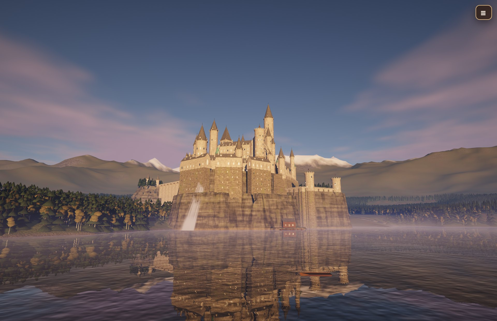
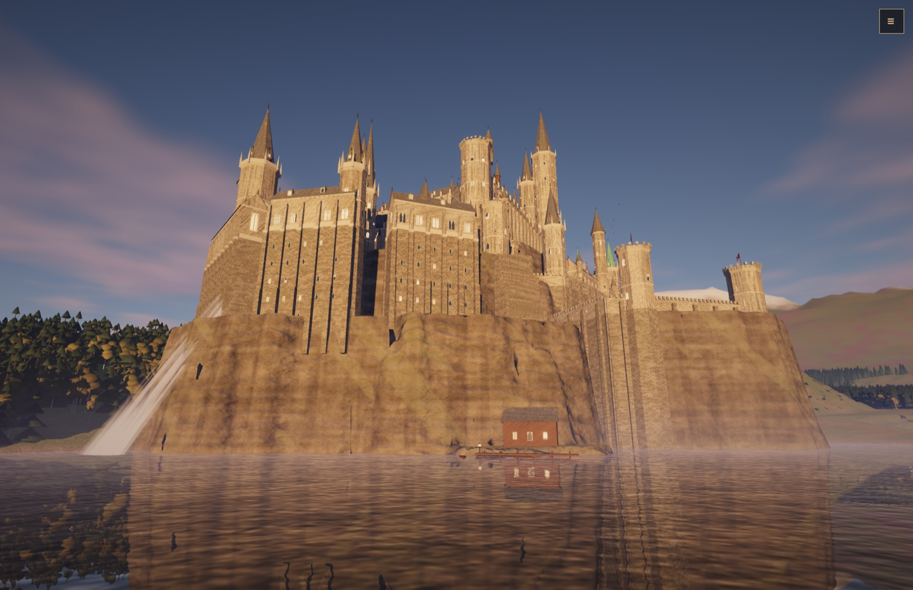
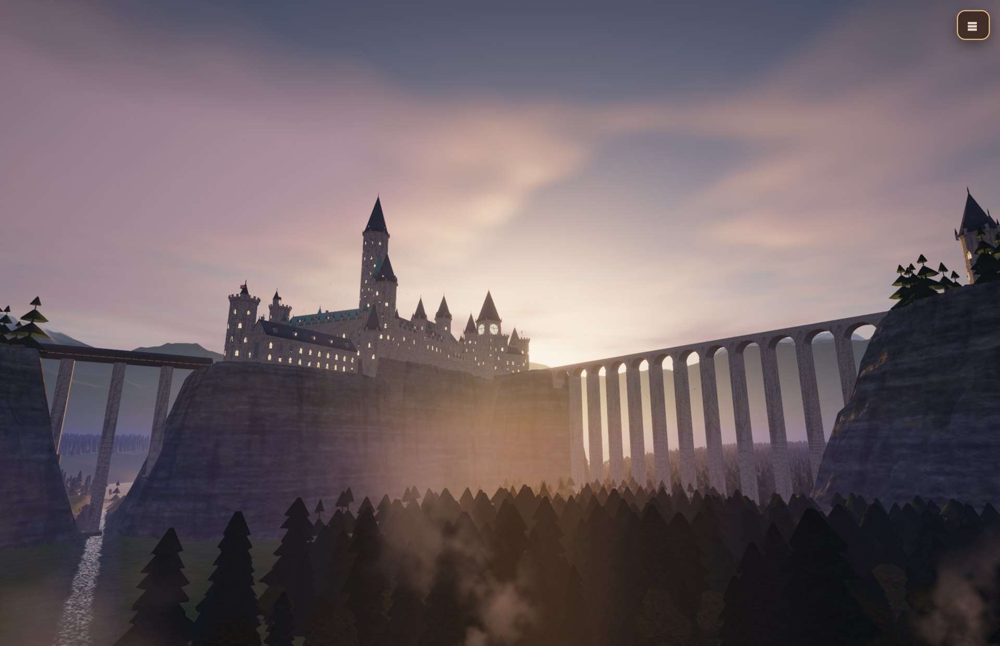
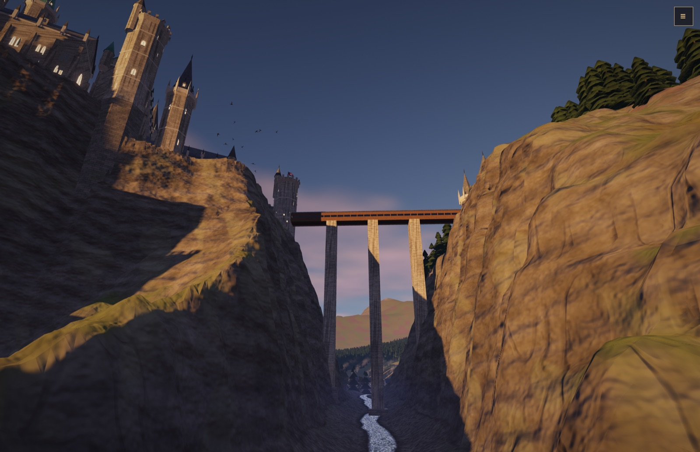
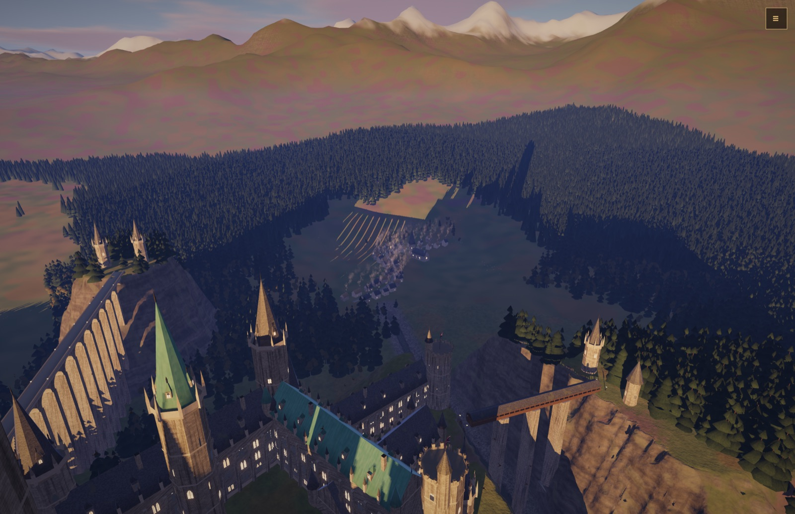

# Wrenhollow

**A Gothic highland castle that you can fly around, right in your browser, from dawn to moonlit night.**

### [▶ Fly it now](https://dipengupta.github.io/wrenhollow/)

Needs a browser with WebGPU: current Chrome or Edge on desktop works best.

Dozens of towers and spires on a sheer crag above a dark loch, hundreds of warm lit windows, mist on the water, a covered
bridge over a ravine, a stone viaduct, a village with chimney smoke and pine forests running up to snowy mountains.
All of it is made by code: no images, no 3D models, no sound files. The whole world is **one HTML file**.

It is an original place in the spirit of the great fantasy school-castles; no names, crests or layouts from any
existing franchise.



| | |
|---|---|
|  |  |
|  |  |

## Try it

1. Download [`index.html`](index.html).
2. Open it in **Chrome** or **Edge** on a desktop computer.
3. Wait a few seconds while the world is built, then press **Take flight**.

It needs a browser with **WebGPU**.

## Controls

| | Keyboard & mouse |
|---|---|
| Look around | Move the mouse |
| Fly | `W` `A` `S` `D` |
| Down / up | `Q` / `E` |
| Fly faster | Hold `Shift` |
| Jump to a viewpoint | `1` to `6` |
| Menu | `Esc` |
| Sound on / off | `M` |
| Time of day | `T`, or **Time** in the menu |
| Performance stats | `H` |
| Detail level | **Low**, **Medium** or **High** in the menu (reloads the page) |

### Times of day

**Dawn**, **Morning**, **Afternoon**, **Golden hour**, **Dusk** and **Night** (moonlit). The choice is kept in the
address, so a look can be shared: [`?time=night`](https://dipengupta.github.io/wrenhollow/?time=night),
[`?time=dawn`](https://dipengupta.github.io/wrenhollow/?time=dawn),
[`?time=dusk`](https://dipengupta.github.io/wrenhollow/?time=dusk).

The ground, the walls and the towers are solid. You can fly through the covered bridge and under its arches.

## What's there

- **The castle**: about fifty towers, most of them octagonal with pinnacled parapets and needle spires, buttressed
  halls with traceried lancet windows, a great hall with rose windows and flying buttresses, a chapel, a clock tower, an observatory tower, courtyards, curtain walls with crenellations,
  buildings stepping down the crag, banners on the flat-topped towers
- **The loch**: planar reflections, ripples, a glittering sun path, shoreline foam, a waterfall, a boathouse with a
  cliff stair, rowing boats
- **The land**: a covered timber bridge over a rocky gorge, a multi-arch viaduct, a village with smoking chimneys and a
  church, about 90,000 pines and birches, heather, bracken, rock faces, snow-capped mountains
- **The sky**: a physically based sky for every time of day, drifting clouds, sun shafts, valley mist, and at
  night stars, a band of the galaxy and the moon with its path on the loch
- **Life**: rooks circling the towers, chimney smoke, glowing motes along the shore
- **Sound**: wind that rises with height and speed, lapping water, a distant bell, rooks

## How it works

- The terrain is a height field computed on the graphics card at load time (2049 × 2049 samples at 1 m around the
  castle, a coarser ring out to the mountains), drawn in patches with four levels of detail.
- The castle is assembled from a kit of procedural pieces (towers, halls, roofs, spires, windows, walls) placed by
  a hand-authored layout in [`source/src/castle.js`](source/src/castle.js).
- Everything is drawn with **WebGPU** directly, in HDR with 4× MSAA, a baked shadow map, a mirrored reflection pass
  for the loch, bloom, sun shafts and a filmic tone curve.
- The frame loop allocates nothing; resolution adapts to keep the GPU around 11 ms per frame.

## Make it your own

The readable source code is in the [`source`](source) folder. You need [Node.js](https://nodejs.org) 18 or newer:

```bash
cd source
npm install
npm run build          # writes ../index.html
npm run build:dev      # writes ../dev.html with the dev tools (F: fly the path, B: benchmark)
node shots.mjs poses   # renders the six viewpoints with your installed Chrome
node shots.mjs bench   # runs the 60 s benchmark flight and prints frame and GPU times
```

| File | What's inside |
|---|---|
| [`source/src/castle.js`](source/src/castle.js) | The castle kit and its layout. **A good place to start.** |
| [`source/src/shaders.js`](source/src/shaders.js) | The look: terrain shape, sky, materials, water, clouds, effects (WGSL) |
| [`source/src/main.js`](source/src/main.js) | Renderer, camera, controls, collision, viewpoints and the flight path |
| [`source/src/world.js`](source/src/world.js) | Trees and birds |
| [`source/src/audio.js`](source/src/audio.js) | The soundscape |
| [`source/src/quality.js`](source/src/quality.js) | Detail levels |
| [`source/src/env.js`](source/src/env.js) | Times of day: light direction, colours, exposure, window glow |
| [`source/src/math.js`](source/src/math.js) | Noise, random numbers, the terrain grid and the mesh builder |
| [`source/template.html`](source/template.html) | The page: loading bar, menu and styles |
| [`source/fonts/`](source/fonts) | The menu typeface (Cinzel, subset to Latin), inlined into the page at build time |

Easy first tweaks: the sun direction `SUN` and sky ambient `AMB` near the top of `main.js`, the exposure `EXPO`, the
flight speed (search for `70 : 14`), and the banner colours in `fsBan` in `shaders.js`.

## Credits

Architecture of the renderer and build adapted from [Abyssal Garden](https://github.com/Noniv/abyssal-garden) (MIT).

Menu typeface: [Cinzel](https://github.com/NDISCOVER/Cinzel) by Natanael Gama, SIL Open Font License 1.1
(see [`source/fonts/Cinzel-OFL.txt`](source/fonts/Cinzel-OFL.txt)).
